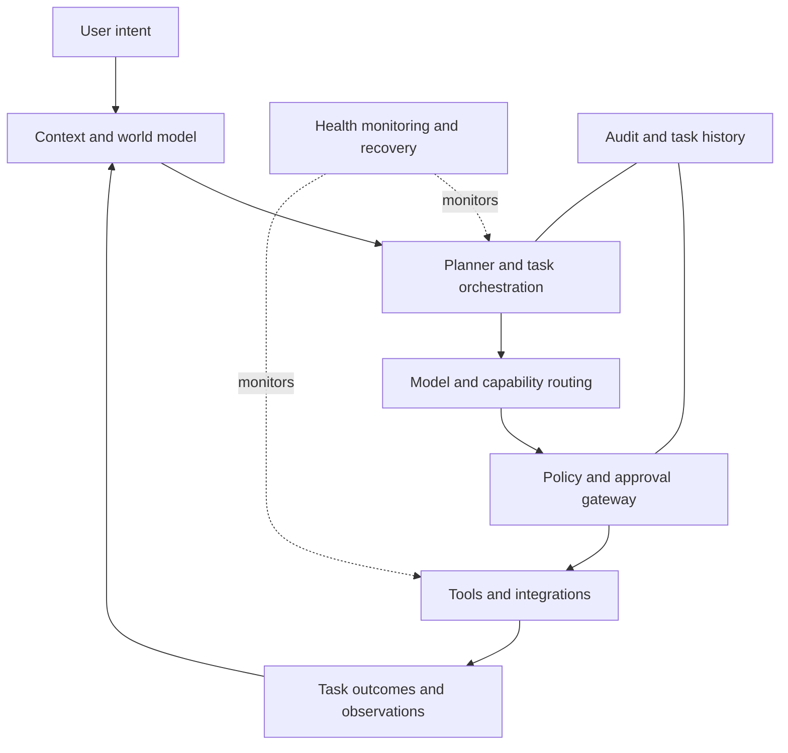

# Pandora

**A persistent personal AI operating system.**

Pandora is an ongoing systems project exploring what happens when AI is treated not as a chat window, but as a persistent software environment that can maintain context, plan work, coordinate specialized capabilities, interact with tools under policy, and monitor its own runtime.

Built by **Jason Ntiri Mauwena**, Pandora is being developed alongside Elixar. This repository is the **public project overview and engineering showcase**. It is intentionally separate from the private implementation repository.

> **Public-scope note:** This repository contains documentation only. It does not contain Pandora's production source, private runtime state, identity profiles, environment files, keys, operational logs, or deployment configuration. Architecture descriptions are high-level and intentionally omit sensitive implementation details.

## Why Pandora exists

Many AI products are organized around a single interaction: ask a question, receive an answer, and start over. Real work is more continuous. It involves context that must survive between sessions, tasks with multiple steps, tools that can change the world, failures that need recovery, and actions that should remain accountable.

Pandora explores a different model: a personal AI environment designed around **continuity, execution, and governed action**.

## System at a glance

- **Persistent context:** retain relevant goals, project state, and working context between interactions.
- **Task orchestration:** represent work as managed tasks, coordinate execution, and make lifecycle transitions explicit.
- **Model and capability routing:** select AI capabilities according to the kind of work being performed.
- **Governed tool use:** route consequential actions through policy checks and approval boundaries rather than treating every tool call as harmless.
- **Runtime observability and recovery:** monitor service health and recover from failures where supported.
- **Integration surface:** connect assistant capabilities, APIs, and selected device or desktop workflows.
- **Cross-platform engineering:** the private project's engineering records document runtime qualification on Windows and Linux.

These are design areas, not a claim that every capability is universally production-ready or works on every device. Details and readiness vary by subsystem.

## High-level architecture

The diagram describes the conceptual boundaries of the system, not the full internal implementation or a guarantee that every path is enabled in every build.

## Engineering approach

Pandora is developed as a system of cooperating components rather than a collection of unrelated demos. The engineering work has included Python application/runtime code, persistent context, task lifecycle controls, model-provider integration, policy/approval boundaries, monitoring, tests, and cross-platform startup behavior.

The project emphasizes:

1. **State that survives:** continuity should be represented in explicit state, not assumed from a chat transcript.
2. **Actions with boundaries:** the system should distinguish low-risk assistance from consequential operations that require stronger controls.
3. **Observable execution:** task state, failures, and runtime health should be inspectable.
4. **Evidence over labels:** features and reliability claims should be backed by tests or reproducible demonstrations.

See [Architecture](docs/architecture.md), [Governance and safety principles](docs/governance.md), and [Engineering evidence](docs/engineering-evidence.md).

## Current evidence and limits

The private project's documentation records a test-suite checkpoint of **747 passed, 101 skipped, and 0 failures** following task-lifecycle and queue-pause/resume work in September 2026. That is a documented historical result, **not a test run performed by this public showcase**, and the suite has not been rerun as part of publishing this repository.

The project records also describe a Windows login/autostart qualification with 23 startup stages completing successfully in September 2026. This is reported project evidence; this public repository does not contain the raw operational logs or enough setup to independently reproduce that qualification.

Pandora remains an evolving personal systems project. The public documentation distinguishes implemented and documented behavior from ambitions and future work. It does not claim autonomous general intelligence or unrestricted, reliable operation across all environments.

## What this repository includes

- A high-level architecture overview
- Governance and engineering principles
- A summary of documented engineering evidence
- A public-facing roadmap

## What it deliberately excludes

- Production implementation copied from the private repository
- Environment files, credentials, keys, or vault material
- Personal identity profiles, biometric-enrollment metadata, and runtime memory snapshots
- Operational logs, local file paths, live endpoints, or machine-specific deployment configuration
- Sensitive device-control, financial, drone, cybersecurity, or command/control implementation details

## Roadmap for this showcase

- Publish a sanitized, self-contained demonstration that can be reviewed without access to the private repository.
- Add reproducible public tests for the specific capabilities selected for demonstration.
- Document boundaries and known limitations for each showcased capability.
- Consider releasing individual source components only after separate security, licensing, dependency, and history review.

## About the builder

I'm Jason Ntiri Mauwena, a self-taught technical founder building Elixar and exploring AI systems through Pandora. I enjoy working across the stack—from application interfaces and data models to runtime behavior, task orchestration, and system reliability.

- [GitHub profile](https://github.com/jasonntiri1-create)
- [LinkedIn](https://www.linkedin.com/in/jason-ntiri-153b05418/)
- [Elixar](https://elixar.app)

## Status

**Public architecture and engineering showcase — implementation remains private.**

No license is included yet. The absence of a license does not grant permission to reuse this documentation or any future code beyond rights already provided by applicable law. A license should be added before intentionally opening any reusable implementation.
